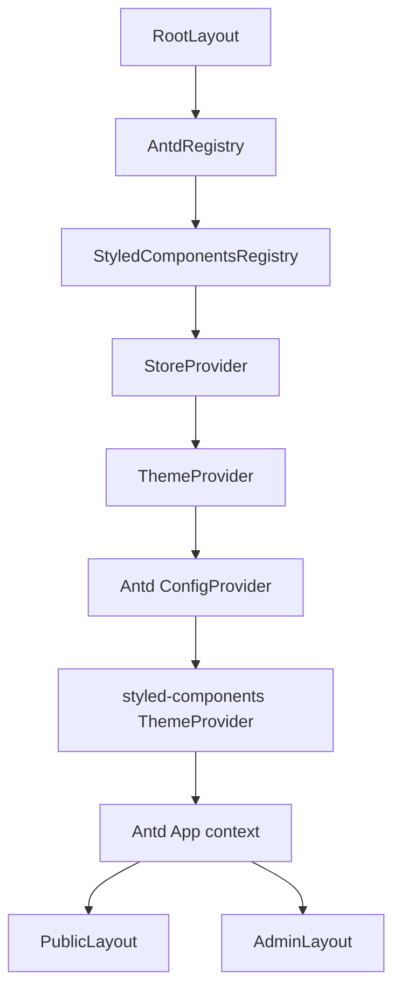
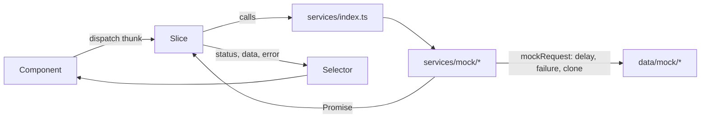

# Architecture

## App Router structure

```
src/app/
  layout.tsx                 Root HTML shell: fonts, default theme CSS, theme bootstrap script, providers
  globals.css                Reset and global element styles (imports styles/tokens.css)
  not-found.tsx              Global 404
  error.tsx                  Root error boundary
  global-error.tsx           Last-resort boundary for root layout failures
  (public)/                  Route group for the public website (own header and footer)
    layout.tsx, page.tsx, privacy/, terms/, support/
  admin/
    layout.tsx               Admin metadata (title template, noindex)
    page.tsx                 Redirects to /admin/dashboard
    login/page.tsx           Demo sign-in, outside the admin shell
    (portal)/                Route group wrapped by the admin shell
      layout.tsx             AdminLayout (sidebar, header, guards)
      loading.tsx            Page skeleton during navigation
      error.tsx              Admin error boundary with retry
      not-found.tsx          Admin 404 rendered inside the shell
      [...slug]/page.tsx     Catch-all that returns the admin 404 for unknown paths
```

Route groups keep the two experiences fully separate. The public site never renders the admin sidebar, and the admin portal never inherits the public header.

## Provider tree



- `AntdRegistry` (`@ant-design/nextjs-registry`) and `StyledComponentsRegistry` collect CSS during server rendering so the first paint is styled.
- `StoreProvider` creates the Redux store once per browser session and restores saved preferences after mount.
- `ThemeProvider` derives Ant Design tokens, styled-components theme and CSS variables from the Redux theme state. See [THEME_SYSTEM.md](THEME_SYSTEM.md).
- Antd `App` provides context-aware `message`, `notification` and `modal` APIs that respect the theme.

## Server and client components

- Public pages, the public header and footer, and route files are Server Components. They use CSS Modules that read the shared CSS variables.
- Interactive pieces are Client Components: the theme switcher, mobile nav, the admin shell, and everything using styled-components or Redux.

## Feature modules

Each domain lives in `src/features/<domain>/` with `<domain>Slice.ts`, `<domain>Selectors.ts` and `<domain>Types.ts`. Phase 1 includes `auth` and `settings` (theme and layout). Other modules are added in later phases following the same shape.

## Data flow



Components never import mock datasets. They dispatch thunks and read typed selectors. Replacing `services/mock/*` with real API clients only changes `services/index.ts`. See [MOCK_API_INTEGRATION.md](MOCK_API_INTEGRATION.md).

## Shared configuration

- `lib/constants/adminRoutes.ts` is the single registry of admin routes. It drives breadcrumbs, page titles and route-level permission checks.
- `lib/constants/adminNavigation.tsx` groups registry entries into sidebar sections with icons.
- `lib/constants/roles.ts` holds the role labels and the permission map.

## Error handling

- Services throw `MockServiceError` (or any error). Thunks convert it with `toServiceError` into a serializable `{ code, message }` stored in the slice, separate from the data.
- UI shows `ErrorState` with a retry action for failed loads. Route-level render errors are caught by `error.tsx` boundaries, which offer `retry()`.
- Unknown admin paths call `notFound()` and render the admin 404 inside the shell. Unknown public paths render the global 404.

## Configuration decisions

**Cache Components is disabled.** `create-next-app` enabled `cacheComponents` and `partialPrefetching`. Ant Design 6's CSS-in-JS reads `Date.now()` (in `@ant-design/cssinjs-utils`) and `Math.random()` (in `@ant-design/cssinjs` `createCache`) while rendering. Cache Components rejects those during prerendering, so every route would fail the build unless the whole tree were wrapped in Suspense and made dynamic. Disabling the flag keeps public pages static and the build reliable. Revisit if Ant Design adds Cache Components support.
