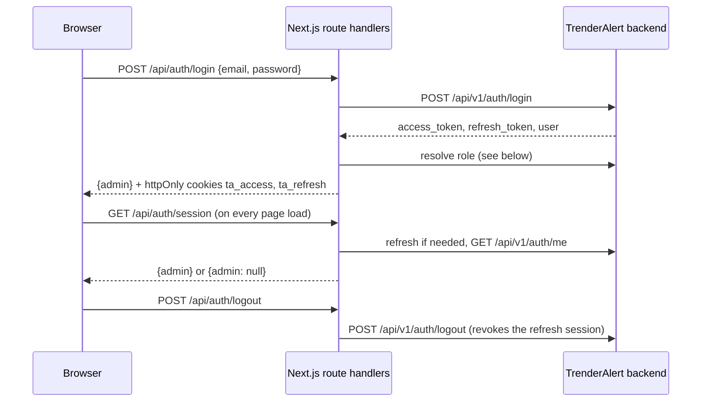

# Authentication and Roles

## Backend authentication

Administrators sign in at `/admin/login` with the email and password issued by the backend team. Credentials are never stored in the frontend code or in `localStorage`.

- **Route handlers** (`src/app/api/auth/{login,session,logout}/route.ts`) are the only code that talks to the backend auth API. They use `src/server/backendAuth.ts`, which reads `TRENDERALERT_API_URL` (server-only environment variable).
- **Tokens** live in `ta_access` (expires with the JWT, 60 minutes) and `ta_refresh` (30 days) cookies: `HttpOnly`, `SameSite=Lax`, `Secure` in production. Browser JavaScript cannot read them, and Redux only holds the admin identity (`id`, `displayName`, `email`, `username`, `role`).
- **Session restore:** `StoreProvider` dispatches `restoreSession()` on load. The session route refreshes the access token when it is missing or within a minute of expiry, then validates it with `GET /api/v1/auth/me`.
- **Rejected sign-ins:** wrong credentials (401, "Incorrect email or password."), accounts that are not `ACTIVE`, and users without an administrator role. For the last two the new backend session is revoked immediately.

### How the role is resolved

The backend's login response, JWT and `/auth/me` do not include the administrator role. `resolveAdminRole` therefore checks, in order:

1. `user.role` or `user.admin_role` (preferred; not returned by the backend yet);
2. a `role` claim in the access token (not issued yet);
3. `GET /api/v1/admin/roles`, which lists every assignment but is only allowed for Super Admins;
4. for other roles, the role named in that endpoint's 403 message ("Role 'SUPPORT_AGENT' does not have permission…").

Step 4 is an interim workaround. **Backend request:** return the caller's role (for example `user.role`) from `/auth/login` and `/auth/me`; steps 1 and 2 will then pick it up with no frontend change.

Backend role names map to frontend roles as follows: `SUPER_ADMIN` → `super_admin`, `CONTENT_MODERATOR` → `content_moderator`, `SUPPORT_AGENT` → `support_agent`, `FINANCE_ADMIN` → `finance_admin`, `CONTEST_ADMIN` → `contest_admin`.

### MFA

The backend marks every admin account `mfa_enabled`, but `/auth/login` does not ask for a second factor yet. The sign-in screen does not imitate one; add the step when the backend exposes it.

### Exploring roles

Sign in with each administrator account supplied by the backend team (ask them for credentials; they are not kept in this repository). To change role, sign out and sign in with another account. The demo role switcher has been removed.

## Roles

Role summaries follow the specification's "Roles and permissions" table.

| Role                  | Summary                                                                                          |
| --------------------- | ------------------------------------------------------------------------------------------------ |
| Super Administrator   | Manages roles and system configuration. All actions audited.                                     |
| Content Moderator     | Reviews reports and applies policy actions with audit logs.                                      |
| Support Agent         | Views support cases and limited account metadata. Cannot view secrets or payment credentials.    |
| Finance Administrator | Reconciles transactions, refunds, fees and payouts. No content moderation authority by default.  |
| Contest Administrator | Manages an approved contest within locked rules. Cannot change material terms after publication. |

## Permission configuration

Permissions are defined in `src/types/auth.ts` and mapped to roles in `src/lib/constants/roles.ts` (`ROLE_PERMISSIONS`). Use `roleHasPermission(role, permission)` or the `selectHasPermission` selector.

| Permission                                | Super | Moderator | Support | Finance | Contest |
| ----------------------------------------- | :---: | :-------: | :-----: | :-----: | :-----: |
| dashboard:view                            |  Yes  |    Yes    |   Yes   |   Yes   |   Yes   |
| operations:view                           |  Yes  |           |         |         |         |
| users:view                                |  Yes  |    Yes    |   Yes   |         |         |
| users:manage                              |  Yes  |           |         |         |         |
| content:view                              |  Yes  |    Yes    |         |         |   Yes   |
| content:moderate                          |  Yes  |    Yes    |         |         |         |
| trends:view / trends:manage               |  Yes  |    Yes    |         |         |         |
| discovery:view / discovery:manage         |  Yes  |           |         |         |         |
| moderation:view / moderation:act          |  Yes  |    Yes    |         |         |         |
| appeals:view / appeals:decide             |  Yes  |    Yes    |         |         |         |
| copyright:view / copyright:manage         |  Yes  |    Yes    |         |         |         |
| contests:view                             |  Yes  |           |         |   Yes   |   Yes   |
| contests:manage                           |  Yes  |           |         |         |   Yes   |
| subscriptions:view                        |  Yes  |           |   Yes   |   Yes   |         |
| finance:view / finance:manage             |  Yes  |           |         |   Yes   |         |
| support:view / support:manage             |  Yes  |           |   Yes   |         |         |
| configuration:view / configuration:manage |  Yes  |           |         |         |         |
| security:manage-admins                    |  Yes  |           |         |         |         |
| audit:view                                |  Yes  |           |         |         |         |

Assumptions (conservative, to be confirmed by the owner):

- Content moderators can view users (needed to act on reported accounts) but not change account status outside moderation actions.
- Support agents can view subscriptions to answer entitlement questions but not finance records.
- Finance administrators can view contests for payout context but cannot manage them.
- Contest administrators can view content to review entries.

## Route-level restrictions

Each admin route declares a permission in `ADMIN_ROUTES`. The sidebar hides routes the role cannot open, and `RouteAccessGuard` in `AdminLayout` replaces the page with an access-restricted state if a role navigates to one directly.

## Action-level restrictions

Two helpers enforce action-level UI restrictions (Phase 3):

- `usePermission(permission)` / `usePermissionChecker()` in `src/features/auth/usePermission.ts`.
- `<Can permission="users:manage" fallback={...}>` in `src/components/auth/Can.tsx`.

`RowActions` items accept a `permission` and are hidden when the role lacks it. Module screens (Phase 5 onward) use these for every `*:manage`, `*:act` and `*:decide` action. As with route checks, these restrictions are UI-only.

Phase 6 action permissions:

| Screen                                | View                     | Act                                    |
| ------------------------------------- | ------------------------ | -------------------------------------- |
| Contests                              | `contests:view`          | `contests:manage`                      |
| Subscriptions                         | `subscriptions:view`     | None (store-managed, read-only)        |
| Finance, transactions, reconciliation | `finance:view`           | `finance:manage`                       |
| Support                               | `support:view`           | `support:manage`                       |
| Discovery                             | `discovery:view`         | `discovery:manage`                     |
| Configuration, feature flags          | `configuration:view`     | `configuration:manage`                 |
| Admin users                           | `security:manage-admins` | `security:manage-admins`               |
| Audit logs                            | `audit:view`             | None (append-only; export disabled)    |
| Operations                            | `operations:view`        | Acknowledge incident (same permission) |

## Administrator accounts (Phase 6)

The Admin users screen lists fictional demo administrators, with role, status and MFA status. Rules shown in the demo and expected from the backend:

- Administrators cannot change their own role or deactivate themselves.
- At least one active Super Administrator must remain.
- Invitations record an invited account only; no email is sent, and demo invites must use the fictional `@demo.trenderalert.test` domain.
- MFA is displayed as a status. No passwords, tokens or MFA secrets exist anywhere in the frontend.

Changing a role on this screen only changes demo data. Real role assignments are made in the backend (`POST /api/v1/admin/roles/assign`, not connected yet).

## Production authentication requirements

Before production use, the backend must provide:

- Real administrator authentication with strong credentials and multi-factor authentication (the specification requires strong authentication for super administrators).
- Server-side authorization for every request. Frontend role checks are convenience only.
- Server-issued sessions (for example httpOnly cookies) instead of `localStorage`.
- Audit logging of every administrative action on the server.
- Role assignment managed by super administrators and itself audited.

The exact authentication scheme and endpoints are not defined yet. Anything in this frontend that hints at them is a proposal.
