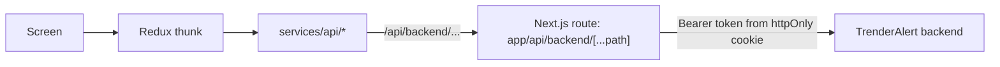

# Backend Integration

The admin portal talks to the TrenderAlert backend (`TRENDERALERT_API_URL`, server-only) for sign-in and for every module listed below. Modules not listed still run on demo data and are labelled "Demo data".

## How requests flow

- **Proxy** (`src/app/api/backend/[...path]/route.ts`): adds the access token from the `ta_access` cookie, refreshes it with `ta_refresh` when it is about to expire (and once more on a 401), and maps backend errors to `{ error: { code, message } }`. Only allow-listed paths are forwarded: `api/v1/admin/*`, `api/v1/trends`, `api/v1/trends/{id}`, `api/v1/trends/topics/{id}/score`, `api/v1/radar/journey/{id}`, `api/v1/radar/heat-zones` and `health`. Anything else returns 404 without reaching the backend.
- **Client helper** (`src/services/api/http.ts`): `apiRequest`, `pageQuery`, `toPaginated` (reads `{ items, total_count }` envelopes, or detects "more pages" for bare arrays), `listItems`, `paginateLocally` and `utc` (backend timestamps have no zone and are UTC).
- **Session end**: a 401 from the proxy fires `ta:session-ended`; the admin shell clears the session and redirects to sign-in with a "Your session has ended" notice.
- **Actions**: real actions use `useApiAction` (success toast, no demo audit event). The backend writes the audit record itself.

## Connected modules

| Screen                   | Backend endpoints                                                                                         | Notes                                                                                                       |
| ------------------------ | --------------------------------------------------------------------------------------------------------- | ----------------------------------------------------------------------------------------------------------- |
| Sign-in                  | `POST /auth/login`, `/auth/refresh`, `/auth/logout`, `GET /auth/me`                                       | Role from `user.admin_role`                                                                                 |
| Dashboard (live section) | `GET /admin/dashboard/metrics`, `GET /health`, moderation queue (open + in review), audit logs (latest 6) | Business metrics below stay demo and are labelled                                                           |
| Users, member detail     | `GET /admin/users?q&status&is_minor&limit&offset`                                                         | Read-only. Contact details masked unless the role has `users:manage` (Super Admin)                          |
| Trends                   | `GET /trends/`, `GET /trends/{id}`, `GET /trends/topics/{topic}/score`, `GET /radar/journey/{topic}`      | Read-only; search, filters, sort and paging are done in the portal (the endpoint returns all active Trends) |
| Discovery → Ranking      | `RANKING_ALGORITHM_V14` feature flag (`*_weight_pct` values)                                              | Weights must total 100%; save needs a justification. Other Discovery tabs are demo                          |
| Moderation queue         | `GET /admin/moderation/queue?category&status_filter&priority&limit&offset`                                | Exact totals from `total_count`                                                                             |
| Moderation report        | `GET /admin/moderation/queue/{id}`, `POST …/assign`, `POST …/notes`, `POST …/action`                      | Actions: Dismiss, Warn, Suppress content, Restrict features, Suspend, Ban; justification ≥ 10 characters    |
| Appeals                  | `GET /admin/appeals?status_filter&limit&offset`, `GET /admin/appeals/{id}`, `POST …/resolve`              | Uphold or overturn with a written reason                                                                    |
| Feature flags            | `GET` / `POST /admin/configs/feature-flags`                                                               | Settings JSON, regions, justification. `ENABLE_PAID_CONTESTS` cannot be switched on from the portal         |
| Admin users              | `GET /admin/roles`, `POST /admin/roles/assign`, `POST /admin/roles/{user_id}/revoke`                      | Cannot change or revoke your own role                                                                       |
| Audit logs               | `GET /admin/audit-logs?limit&offset`                                                                      | Append-only; actor and target names shown; export disabled                                                  |
| Support → Account lookup | `POST /admin/support/user-lookup`                                                                         | Ticket reference required; masked data                                                                      |
| Operations (live status) | `GET /health`, `GET /admin/dashboard/metrics`                                                             | Objectives, queues and incidents remain simulated                                                           |

Value lists (categories, statuses, actions, trend stages, priority SLAs) match `GET /admin/meta/values`. Priorities are labelled by SLA (`P1 · 1 h SLA` … `P5 · 48 h SLA`) because the backend's priority names describe categories.

## Role access (verified per account)

| Endpoint                                                | Super Admin | Moderator | Finance | Contest | Support |
| ------------------------------------------------------- | :---------: | :-------: | :-----: | :-----: | :-----: |
| Dashboard metrics, health, Trends, feature flags (read) |      ✓      |     ✓     |    ✓    |    ✓    |    ✓    |
| Moderation queue, appeals                               |      ✓      |     ✓     |   403   |   403   |   403   |
| Audit logs, admin roles                                 |      ✓      |    403    |   403   |   403   |   403   |
| Support lookup                                          |      ✓      |     —     |    —    |    —    |    ✓    |

The portal hides screens a role cannot use; the backend remains the authority.

## Known backend issues (reported)

- `POST /admin/moderation/queue/{id}/assign` with `admin_user_id: null` does not clear the assignment. The portal reports an error instead of claiming success.
- The action endpoint accepts actions on resolved reports (a WARN changed a dismissed report to Action taken). The portal blocks actions on resolved reports.
- `GET /admin/users` returns full emails and phone numbers to Support Agents. The portal masks them, but the backend should too.
- `GET /trends/` still returns the `MAINSTREAM` stage, which is missing from `/admin/meta/values`.
- No endpoint returns a single audit entry or a single user; the portal searches the list.

## Test data changed during integration

On 2026-10-29 the following was done as the Super Administrator with justifications starting "QA test – frontend integration":

- Report `11111111-0000-0000-0000-000000000003` (Spam): assigned to the Super Admin, a note appended, dismissed, then (by a deliberate negative test the backend should have rejected) warned. It is now **Action taken**.
- Feature flag `ENABLE_OPPORTUNITY_RADAR` saved with unchanged values.
- Role `CONTENT_MODERATOR` re-assigned to the moderator account with unchanged values.

All of these appear in the audit log.

## Adding the next endpoint

1. Add the contract to `services/contracts/backendServices.ts` and the implementation in `services/api/`.
2. Map backend field names to the portal type in the service (never in components).
3. If the path is new, add it to `ALLOWED_PATHS` in the proxy.
4. Point the registry (`services/index.ts`) at the new service and delete the mock service and its data.
