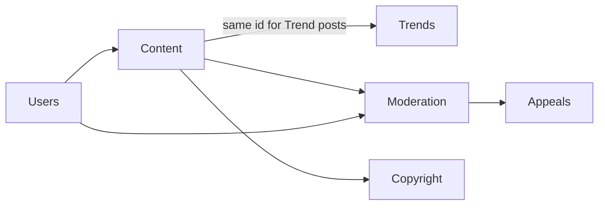

# Mock Data Guide

## Where mock data lives

`src/data/mock/` contains one file per entity type, re-exported from `src/data/mock/index.ts`. Only the mock services in `src/services/mock/` may import it. Components and slices never import mock data.

| File            | Entity                                                                                              | Phase |
| --------------- | --------------------------------------------------------------------------------------------------- | ----- |
| `adminUsers.ts` | `DemoAdminAccount` (one per admin role)                                                             | 1     |
| `dashboard.ts`  | Daily metric records, breakdown weights, activity, pending cases, exceptions, system health, alerts | 4     |

| `seed.ts` | Shared seeded random generator, `DEMO_AS_OF`, date helpers, fictional name and place pools | 5 |
| `users.ts` | 60 `PlatformUser` records (`usr-1001`…`usr-1060`) | 5 |
| `trends.ts` | 60 `TrendRecord` discovery records (`trd-8790`…`trd-8849`) | 5 |
| `content.ts` | 100 `ContentItem` records (60 Trend posts, 40 Profile Posts `pst-22000`…`pst-22039`) | 5 |
| `moderation.ts` | 119 `ModerationCase` records (`mod-0929`…`mod-1047`) | 5 |
| `appeals.ts` | 15 `Appeal` records (`app-0400`…`app-0414`) | 5 |
| `copyright.ts` | 12 `CopyrightCase` records (`cpy-110`…`cpy-121`) | 5 |
| `auditHistory.ts` | Seeded `AuditEvent` history derived from case outcomes and Trend history | 5 |

### Relationships (Phase 5)

- Every `creatorId`, `accountId`, `contentId` and `caseId` resolves to a seeded record (checked by script).
- Content states are pre-assigned so seeded outcomes match: removed content has a remove case (or a copyright removal); restricted and suspended users have a matching case.
- Open moderation cases equal the dashboard's pending KPI, with the same category split as the dashboard donut.
- Ids referenced by the dashboard and alerts (`mod-1039`, `mod-1041`…`mod-1047`, `trd-8841`, `pst-22019`, `app-0412`, `cpy-118`, `usr-1044`, `usr-1045`) exist with matching values.

### In-memory demo database

`src/services/mock/db.ts` deep-clones every dataset once when the app loads. Mock services read and change only this copy, so a demo action in one module is visible in the others (for example, suspending from a case changes the user). Seeded arrays are never mutated, and a page refresh restores the seed. Report counts on users and content are derived from cases when the database loads.

### Generated series (`dashboard.ts`)

Time series are generated, not hand-written, but remain deterministic:

- `DEMO_AS_OF` (`2026-10-28T00:00:00Z`) is the fixed "today" of the demo. Never use the real clock for mock data.
- `DASHBOARD_DAILY` holds 180 days produced by a fixed-seed generator (mulberry32, seed `20261028`) with gentle growth and weekend seasonality. Changing the seed or formulas changes every dashboard figure, so document such changes in the changelog.
- Breakdowns (moderation categories, subscription plans) are weights that the service splits with largest-remainder rounding, so the parts always add up to the KPI total.
- Record ids in panels (`mod-1047`, `rec-2207`, `ctst-301`, `sup-3318`) are reserved for the matching module datasets in Phases 5 and 6, which must reuse them.

Planned files (users, content, trends, moderation, appeals, contests, subscriptions, transactions, reconciliation, support cases, discovery, feature flags, audit logs, dashboard) are added with their modules.

## TypeScript types

Every entity has an interface. Shared types live in `src/types/`; domain types in `src/features/<domain>/<domain>Types.ts`. Mock records are typed with those interfaces so a shape change fails type checking.

## Rules

1. Fictional data only. No real people, organizations, emails or locations that imply real activity.
2. Deterministic: fixed ids and fixed ISO timestamps. Never use `Math.random()` or `Date.now()` to build records.
3. Consistent ids with readable prefixes (`adm-001`, later `usr-…`, `trd-…`, `mod-…`) and valid cross-references between files.
4. Enough records to exercise filtering, sorting, pagination and empty states.
5. Never present mock metrics as real platform activity. The UI shows a demo banner and labels demo figures.

## Adding records

1. Add records to the relevant file using the existing interface.
2. Keep ids unique and references valid.
3. If you add a field, update the interface first and fill it for every record.

## How demo operations update state

Mock services return deep clones (`structuredClone`), so the source arrays are never mutated. Demo mutations update Redux state through reducers. A page refresh therefore resets demo changes, which keeps the demo repeatable.
